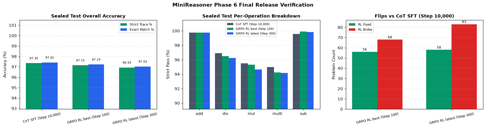
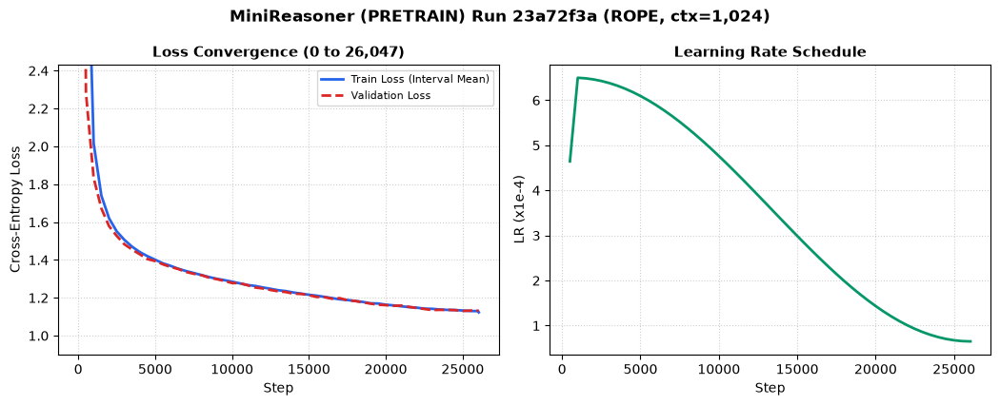
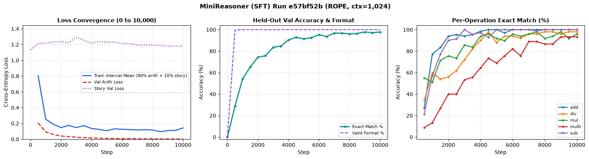

# MiniReasoner

A from-scratch **32.05M RoPE Transformer** in PyTorch exploring how pre-training, Direct vs. Scratchpad CoT SFT, incremental KV caching, and Strict-Trace GRPO (RLVR) behave on multi-step arithmetic while preserving English story fluency.

## How It Was Built (5 Phases)

1. **Phase 1 — Corpus & Tokenizer:** Trained a digit-isolated `1,024`-token BPE and packed `853.5M` `SimpleStories` tokens.
2. **Phase 2 — Pre-Training:** Trained the `32.05M` RoPE Transformer from scratch for 1 epoch (`26,047` steps).
3. **Phase 3 — Base Evaluation:** Benchmarked held-out story fluency (`3.12` PPL, `86.0%` Story Cloze) and the `0%` zero-shot math baseline.
4. **Phase 4 — Arithmetic SFT & KV Cache:** Fine-tuned Direct vs. CoT Scratchpad (`Work:` + `Answer:`) models with `10%` story replay and added exact-parity KV caching (`4.51x` CPU speedup).
5. **Phase 5 — Strict-Trace GRPO (RLVR):** Trained GRPO with a binary AST trace verifier on `1,198` mined failures before the final Phase 6 sealed evaluation.

## Results at a Glance

Evaluated on held-out `SimpleStories` test stories (`250` stories / `101,970` tokens) and the **single-shot sealed `arith_v3` test split (`6,002` rows)** after all training completed:

| Stage / Checkpoint                       | Run ID     | Arithmetic Accuracy                                  | `SimpleStories` Test                          | Key Outcome                                       |
| ---------------------------------------- | ---------- | ---------------------------------------------------- | --------------------------------------------- | ------------------------------------------------- |
| **Base** (26,047 steps)                  | `23a72f3a` | `0.0%` (`0/10` zero-shot)                            | **PPL `3.12`** · BPB `0.5426` · Cloze `86.0%` | 1 epoch over `853.5M` tokens                      |
| **Direct SFT** (8,000 steps)             | `ef3cc27c` | `88.8%` val (`213/240`)                              | `1.2021` story val loss                       | Bottlenecked on `mul_3d` (`3/10`)                 |
| **CoT Scratchpad SFT** (10,000 steps) 🏆 | `e57bf52b` | **`97.35%` strict / `97.42%` exact** (`5,843/6,002`) | **PPL `3.31`** · BPB `0.5697` · Cloze `83.0%` | **Release winner** · `100.0%` wording gen         |
| **GRPO RL `best`** (Step 100)            | `486683da` | `97.15%` strict / `97.23%` exact (`5,831/6,002`)     | **PPL `3.32`** · BPB `0.5708` · Cloze `83.0%` | `fixed=56, broke=68` (`net=-12`) · `sub` `99.92%` |
| **GRPO RL `latest`** (Step 300)          | `486683da` | `96.93%` strict / `97.03%` exact (`5,818/6,002`)     | **PPL `3.32`** · BPB `0.5709` · Cloze `83.0%` | Train reward `1.0000` · `fixed=58, broke=83`      |



## Key Takeaways

- **Scratchpad CoT eliminates the multiplication bottleneck:** Decomposing 3-digit math and PEMDAS/word problems into place-value `Work:` steps lifted arithmetic from `88.8%` val (`mul_3d = 30%`) to `97.42%` exact on `6,002` sealed test rows, while `10%` story replay kept `SimpleStories` PPL at `3.31` (vs. `3.12` base).
- **Clean systems & leakage hygiene:** Digit-isolated `1,024`-vocab byte BPE (`SimpleStories`), FP32 RoPE rotations (`10L / 8H / 512D`, `1,024` context), canonical deduplication before `train/val/test` splits (no `7+8`/`8+7` leakage), `-100` prompt masking, and incremental KV caching with equal-length batching (`4.51x` CPU speedup, exact greedy parity).
- **Strict binary AST verifier (`{0.0, 1.0}`):** Rejects missing `<|eos|>`, bad formatting, tautologies, or any invalid `Work:` equation—catching "lucky-answer hallucinations" where exact match alone passes broken reasoning (e.g., `Work: 39*10=390; 702-390=212; 39*8=212; 10+8=18 // Answer: 18`).
- **Why CoT SFT shipped over GRPO:** Failure-only mining yielded `1,198` `train` rows from `236` failed canonicals (`83%` `div`/`multi`). GRPO drove hard-train reward from `0.5469` (Step 50) to `1.0000` (Step 300) with low KL (`0.0125`), lifting `sub` to `99.92%`, yet over-decomposed 1-step divisions (e.g., `990/33=30`) without passing-problem anchor replay (`fixed=56, broke=68`).

## Training Progression

|              Base Pre-Training (`853.5M` tokens)               |         CoT Scratchpad SFT (`arith_v3` + 10% replay)          |
| :------------------------------------------------------------: | :-----------------------------------------------------------: |
|  |  |

## Architecture & Setup

- **Model (`PRESETS["base"]` in [src/settings.py](src/settings.py)):** `32,049,152` params, `10` layers, `8` heads (`head_dim = 64`), `n_embd = 512`, `RoPE` (`theta = 10,000`), `1,024` context window, `1,024`-token digit-isolated BPE.
- **Corpus:** [`SimpleStories/SimpleStories`](https://huggingface.co/datasets/SimpleStories/SimpleStories) ([arXiv:2504.09184](https://arxiv.org/abs/2504.09184), snapshot `e63b8adc3b1a1bdc7cac5b500d150b71346b0628`), split 99/1 (`2,094,643` train / `21,053` val stories).
- **Environment:** Copy [.env.example](.env.example) to `.env` for Azure Blob checkpoints (`minireasoner`), Databricks MLflow (`/Shared/MiniReasoner`), and optional `RCLONE_CONFIG_BASE64` (`gdrive:MiniReasoner/data`). On a fresh CUDA VM:

```bash
curl -fsSLo /tmp/jarvis_labs.sh https://raw.githubusercontent.com/sampath017/MiniReasoner/main/scripts/jarvis_labs.sh
bash /tmp/jarvis_labs.sh
```

## Quickstart CLI & Notebooks

All training runs launch detached inside `tmux` via [scripts/train.sh](scripts/train.sh) with per-run logs in `logs/`:

```bash
# 1. Pre-train base model (1 epoch, ~26,047 steps on A30 BF16)
bash scripts/train.sh --preset base

# 2. Prepare SFT data & run CoT Scratchpad SFT (10k steps)
bash scripts/prepare_data.sh --format cot --multistep
bash scripts/train.sh sft --preset sft_scratchpad

# 3. Mine strict-verifier failures & run GRPO RL (300 steps)
bash scripts/prepare_data.sh --stage rl
bash scripts/train.sh grpo --preset grpo

# Monitor / attach / stop cleanly / prune deleted MLflow blobs
bash scripts/train.sh status   # or: attach | logs | stop
uv run python src/main.py cleanup [--delete]
```

Evaluate locally on CPU or CUDA via `notebooks/`:

- [phase3_base_evaluation.ipynb](notebooks/phase3_base_evaluation.ipynb) — Base `SimpleStories` PPL/BPB, Story Cloze, RoPE scaling & 0-shot math baseline
- [phase4a_sft_direct.ipynb](notebooks/phase4a_sft_direct.ipynb) — Direct SFT (`arith_v2`, `88.8%` val)
- [phase4b_sft_cot.ipynb](notebooks/phase4b_sft_cot.ipynb) — CoT Scratchpad + Multi-Step SFT (`arith_v3`)
- [phase4c_sft_kv_cache.ipynb](notebooks/phase4c_sft_kv_cache.ipynb) — KV-cache parity/speedup (`4.51x` CPU) & full `6,002`-row `val` eval
- [phase5_grpo_rl.ipynb](notebooks/phase5_grpo_rl.ipynb) — Strict-trace GRPO RL evaluation
- [phase6_final_release.ipynb](notebooks/phase6_final_release.ipynb) — Final single-shot sealed `test.jsonl` (`6,002` rows) comparison & provenance

See [COOKBOOK.md](COOKBOOK.md) for the complete phase-by-phase build playbook and run logs.
